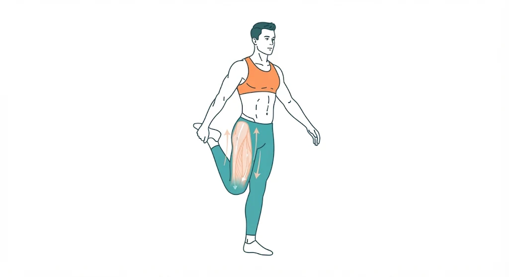
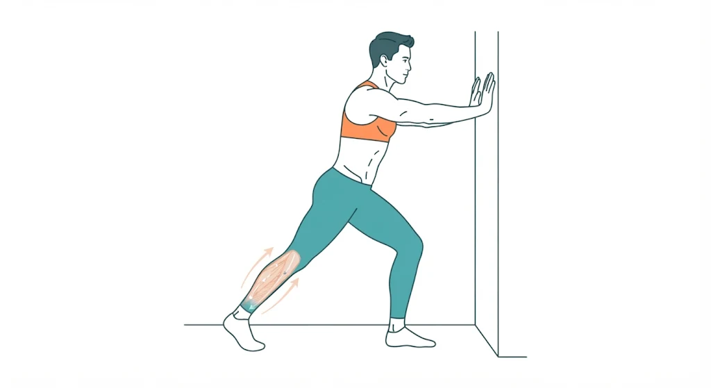
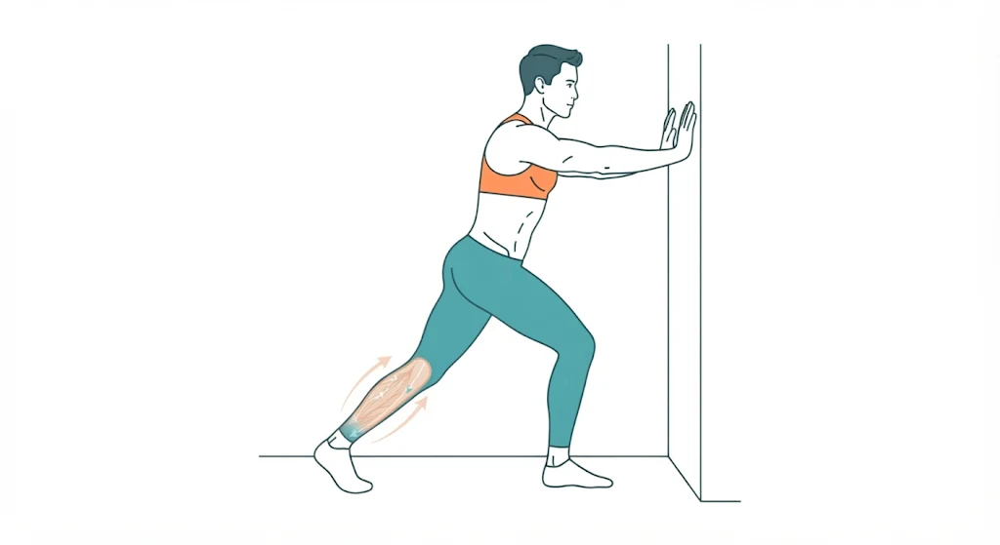
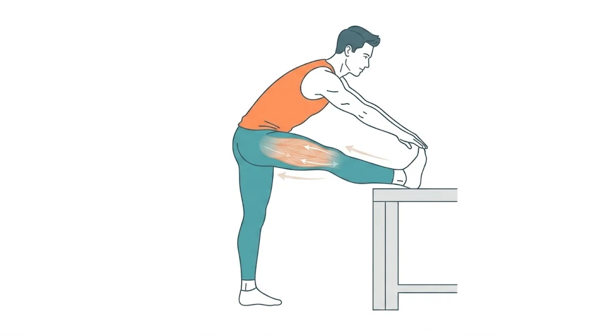
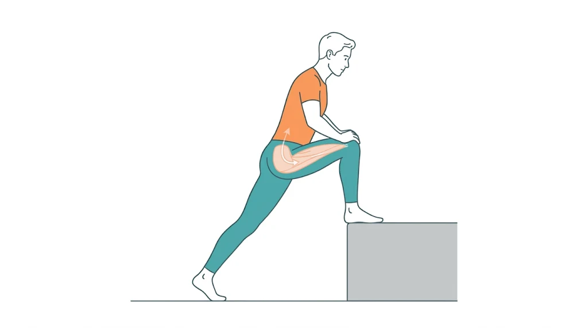
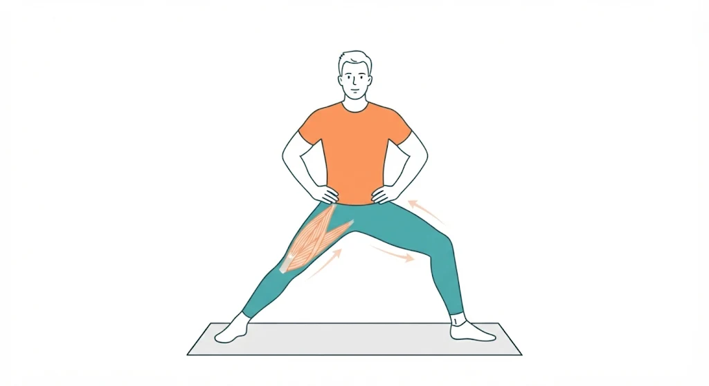
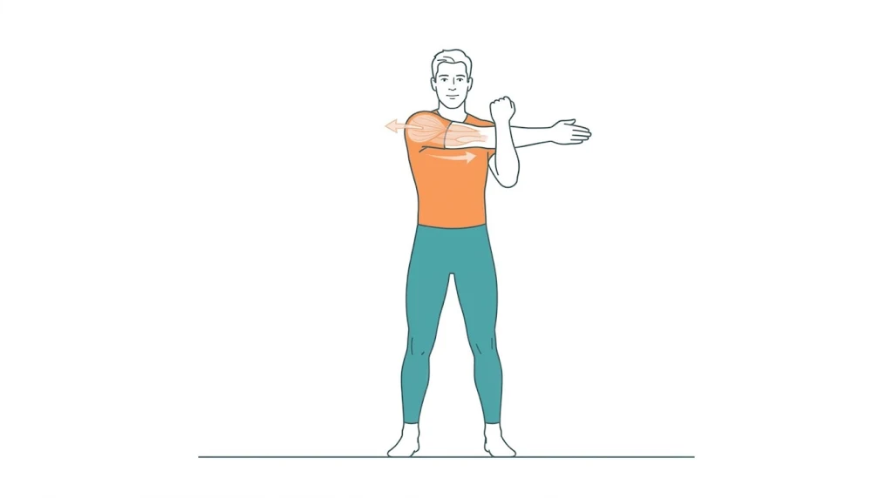
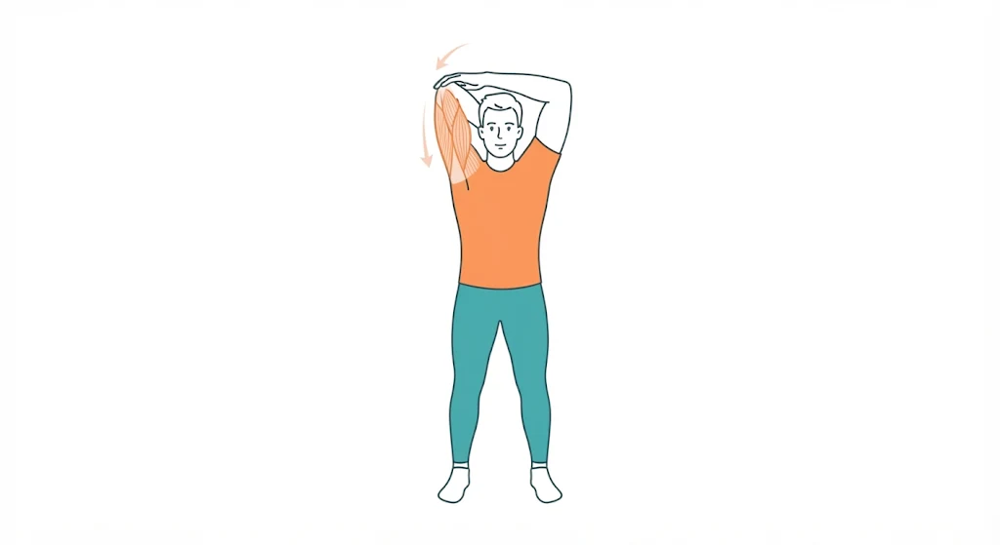

# Gli esercizi di stretching post corsa

Il [capitolo 9](09-stretching.md) spiega a cosa serve lo stretching statico e a cosa no; lo stretching a terra, sul tappetino, è nel [capitolo 10b](10b-esercizi-stretching-tappetino.md). Questo capitolo è la parte pratica: **come si fanno gli esercizi subito dopo la corsa, al parco**, con le figure. Tutti si fanno **in piedi, con le scarpe**, senza tappetino né asciugamano; per ognuno c'è anche quale appoggio usare, al parco o a casa.

Gli esercizi sono in due gruppi:
- **il blocco base**, da fare ogni volta;
- **gli esercizi opzionali**, da aggiungere **a rotazione**, uno o due per volta, per non fare sempre la stessa routine. Se il tempo è poco, un opzionale prende il posto dell'esercizio base della stessa zona.

In ogni figura la zona colorata è il muscolo che si allunga, dove va sentita la tensione.

## Le regole, in breve
- **Solo a fine corsa**, a muscoli caldi: mai prima, al posto del riscaldamento.
- **20-30" per esercizio e per lato**, fino a 45" sui punti più rigidi, **1-2 volte**.
- **Tensione leggera, mai dolore**: si arriva al punto in cui si sente tirare e lì ci si ferma. Niente molleggi.
- **Respiro lento**: a ogni espirazione si può andare un poco più in là, senza forzare.
- **Ogni esercizio su entrambi i lati.** Sul lato più rigido si può fare una ripetizione in più.

# Il blocco base

## Le gambe: la coscia

### Quadricipite (in piedi)

- **Dove:** a casa e al parco. Per l'equilibrio basta un appoggio leggero: un muro, una sedia, un albero, oppure niente.
- **Come si fa:** in piedi su una gamba. Si piega l'altro ginocchio e si prende il piede con la mano dello stesso lato, portando il tallone verso il gluteo.
- **Cosa si sente:** tensione davanti alla coscia.
- **Gli errori da evitare:** il ginocchio che si allontana in avanti o di lato (le ginocchia restano vicine), la schiena che si inarca. Per allungare davvero si spinge leggermente il bacino in avanti, come per mettere la "coda sotto".
- **Nello yoga:** simile alla preparazione del ballerino (Natarajasana), senza l'inclinazione in avanti.

## Le gambe: il polpaccio

### Polpaccio, gastrocnemio (gamba dietro tesa)

- **Dove:** a casa e al parco: serve solo un muro (o un albero, un palo).
- **Come si fa:** mani al muro, un piede avanti con il ginocchio piegato, l'altro dietro con la **gamba tesa** e il **tallone a terra**. Si porta il peso in avanti verso il muro.
- **Cosa si sente:** tensione nella parte alta del polpaccio della gamba dietro.
- **Gli errori da evitare:** il tallone che si alza, il piede dietro ruotato verso l'esterno (la punta guarda il muro).

### Soleo (ginocchio dietro piegato)

*Rispetto al polpaccio: piede dietro più vicino al muro e ginocchio dietro piegato, tallone sempre a terra.*

- **Dove:** a casa e al parco, come il polpaccio.
- **Come si fa:** stessa posizione del polpaccio, ma con il piede dietro più vicino e il **ginocchio dietro piegato**, sempre con il tallone a terra. Si scende con il bacino, come per sedersi.
- **Cosa si sente:** tensione più in basso, nel polpaccio vicino al tendine d'Achille.
- **Perché farlo:** il soleo lavora a ogni passo e con il ginocchio teso non si allunga. È l'esercizio più utile per chi ha la caviglia rigida o una storia di fascite plantare o di tendine d'Achille.

**Nota: il sollevamento dei polpacci (calf raise) non è stretching.** È un esercizio di forza, e fa parte del blocco di [forza](17-forza.md). Le due cose si completano: la forza rende il polpaccio più resistente, lo stretching gli restituisce l'escursione dopo la corsa.

### Femorali (ischiocrurali), tallone su un appoggio

- **Dove:** a casa e al parco. L'appoggio va **dal ginocchio all'anca, secondo la flessibilità**: si sceglie l'altezza a cui la schiena resta dritta. Chi è più rigido parte basso (muretto, gradino, sedia); chi è più flessibile può usare un tavolo o lo schienale della panchina.
- **Come si fa:** il tallone sull'appoggio, gamba tesa, punta del piede verso l'alto, gamba d'appoggio dritta. Con la schiena dritta ci si piega in avanti **dalle anche**, le mani verso lo stinco o il piede, fin dove la schiena non si curva.
- **Cosa si sente:** tensione dietro la coscia, tra il gluteo e il ginocchio.
- **Gli errori da evitare:** curvare la schiena per arrivare alle punte dei piedi (si allunga la schiena, non i femorali); un appoggio così alto che il bacino si inclina o la schiena si curva. Se tira dietro al ginocchio invece che sulla coscia, si piega leggermente il ginocchio.
- **Nello yoga:** simile alla piramide (Parsvottanasana), qui con il tallone in appoggio.

## Le anche

### Affondo con il piede su un appoggio (flessori dell'anca e gluteo)

- **Dove:** al parco su un muretto, un gradino alto o una panchina; a casa su un gradino o una sedia contro il muro. L'appoggio deve essere stabile e all'altezza del ginocchio o poco sotto.
- **Come si fa:** il piede davanti tutto appoggiato sopra, con il ginocchio sopra la caviglia; la gamba dietro tesa, con il tallone sollevato. Le mani sul ginocchio davanti. Si porta il bacino in avanti e in basso.
- **Cosa si sente:** dipende da dove va il busto. **Busto dritto, bacino in avanti**: tensione davanti all'anca e all'inguine della gamba dietro (flessori dell'anca, il muscolo che si accorcia stando seduti). **Busto inclinato sulla coscia davanti**, come nella figura: tensione anche nel gluteo della gamba davanti.
- **Gli errori da evitare:** il ginocchio davanti che supera molto la punta del piede o cade verso l'interno, la schiena che si inarca per scendere di più. Si scende con il bacino, non con la schiena. Per allungare a fondo gluteo e piriforme ci sono la figura a 4 in piedi e il piccione sul muretto, tra gli opzionali.
- **Nello yoga:** simile all'affondo alto (Ashta Chandrasana), con il piede davanti rialzato.

### Adduttori (affondo laterale) — *mezza Skandasana*

- **Dove:** ovunque, senza appoggi.
- **Come si fa:** gambe molto larghe, punte in avanti o appena aperte. Si piega **un ginocchio** e si sposta il bacino verso quel lato; l'altra gamba resta tesa, con il piede tutto a terra. Busto dritto, mani sui fianchi o sulle cosce. Poi si cambia lato.
- **Cosa si sente:** tensione all'interno della coscia della gamba tesa, fino all'inguine.
- **Gli errori da evitare:** il ginocchio piegato che cade verso l'interno o supera la punta del piede, il piede della gamba tesa che si solleva sul bordo, il busto che si piega di lato. Piegare il busto a destra e sinistra a gambe tese allunga i fianchi, non gli adduttori.

## Le spalle

### Cross body stretch (braccio davanti al petto)

- **Dove:** ovunque, senza appoggi.
- **Come si fa:** un braccio teso orizzontale davanti al petto, verso la spalla opposta. L'altro braccio lo avvicina al petto spingendo **sopra il gomito**, non sul gomito.
- **Cosa si sente:** tensione dietro la spalla.
- **Gli errori da evitare:** alzare la spalla verso l'orecchio, ruotare il busto per seguire il braccio.

### Pettorali al palo (apertura del petto)
<!-- figura da aggiungere: avambraccio contro un palo, gomito all'altezza della spalla, busto ruotato dalla parte opposta, zona evidenziata davanti al petto e alla spalla -->

- **Dove:** al parco contro un palo, un albero o lo spigolo di un muro; a casa contro lo stipite di una porta.
- **Come si fa:** di fianco al palo, l'avambraccio appoggiato in verticale, con il gomito all'altezza della spalla e piegato ad angolo retto. Si fa un piccolo passo avanti con la gamba dello stesso lato e si ruota piano il busto dalla parte opposta.
- **Cosa si sente:** tensione davanti al petto e alla spalla.
- **Perché farlo:** chi passa molte ore seduto, e a fine corsa ha le spalle chiuse in avanti, ne ha più bisogno del tricipite: apre il petto e aiuta la postura in corsa.
- **Gli errori da evitare:** la spalla che sale verso l'orecchio, il gomito più alto della spalla (si sente nella spalla, non nel petto), la schiena che si inarca.

## La sequenza a fine corsa

Dal basso verso l'alto, così si cambia posizione il meno possibile. Il blocco base dura circa **9-11 minuti**, uno o due opzionali aggiungono 1-2 minuti.

| # | Esercizio | Al parco | A casa | Tempo |
|---|---|---|---|---|
| 1 | Polpaccio (gamba tesa) | muro, albero, palo | muro | 30" per lato |
| 2 | Soleo (ginocchio piegato) | muro, albero, palo | muro | 30" per lato |
| 3 | Femorali (ischiocrurali) | muretto, panchina | sedia, gradino, tavolo | 30" per lato |
| 4 | Affondo con il piede su un appoggio (anca) | muretto, gradino, panchina | gradino, sedia contro il muro | 30" per lato |
| 5 | Adduttori (affondo laterale) | senza appoggi | senza appoggi | 30" per lato |
| 6 | Quadricipite | albero o niente | muro, sedia o niente | 30" per lato |
| 7 | Cross body | senza appoggi | senza appoggi | 20-30" per lato |
| 8 | Pettorali al palo | palo, albero | stipite della porta | 20-30" per lato |

Dopo un lungo o una gara si può arrivare a 45" sui punti più rigidi. Dopo le ripetute brevi basta la sequenza leggera, anche una volta sola per lato.

# Gli esercizi opzionali (a rotazione)

Uno o due per volta, cambiandoli di seduta in seduta. Ognuno può anche **prendere il posto** dell'esercizio base della stessa zona, quando il tempo è poco.

| Esercizio | Zona | Al posto di | Al parco |
|---|---|---|---|
| Figura a 4 in piedi | gluteo, piriforme | affondo sull'appoggio | albero o palo per l'equilibrio |
| Piccione sul muretto | gluteo, piriforme | affondo sull'appoggio | muretto, panchina |
| Quadricipite con il piede dietro sul muretto | quadricipite, flessori dell'anca | quadricipite (o affondo sull'appoggio) | muretto, panchina |
| Gambe larghe, busto verso una gamba | femorali, adduttori | femorali o adduttori | senza appoggi |
| Gambe larghe, busto in avanti | femorali, adduttori | femorali o adduttori | senza appoggi |
| Pattinatore | adduttori, femorali | adduttori | senza appoggi |
| Flessione laterale | fianco, gran dorsale | cross body | senza appoggi |
| Estensione toracica al muro | parte alta della schiena, spalle | pettorali | muro, albero, palo |
| Tricipite | dietro il braccio | cross body o pettorali | senza appoggi |

## Gluteo e piriforme

### Figura a 4 in piedi — *Eka Pada Utkatasana*
<!-- figura da aggiungere: in piedi su una gamba, caviglia dell'altra sopra il ginocchio, seduti indietro, mano su un albero, zona evidenziata sul gluteo della gamba sopra -->

- **Dove:** ovunque; al parco una mano su un albero o un palo per l'equilibrio.
- **Come si fa:** in piedi su una gamba, si appoggia la caviglia dell'altra sopra il ginocchio, con il ginocchio sopra aperto verso l'esterno. Si piega la gamba d'appoggio e ci si siede indietro, come su una sedia invisibile, con la schiena dritta.
- **Cosa si sente:** tensione nel gluteo e sul lato esterno dell'anca della gamba sopra.
- **Gli errori da evitare:** la schiena che si curva in avanti invece di sedersi indietro, il ginocchio d'appoggio che cade verso l'interno. È la versione in piedi della "figura a 4" del capitolo 9.

### Piccione sul muretto
<!-- figura da aggiungere: stinco della gamba davanti di traverso sul muretto, gamba dietro tesa a terra, busto inclinato in avanti a schiena dritta, zona evidenziata sul gluteo della gamba appoggiata -->

- **Dove:** al parco su un muretto o una panchina; a casa sul bordo del letto o su un tavolo basso. L'appoggio va all'altezza dell'anca o poco sotto.
- **Come si fa:** si appoggia la gamba piegata sul muretto con lo **stinco di traverso** (il piede verso l'altra gamba, il ginocchio verso l'esterno); l'altra gamba resta a terra, dietro. Con la schiena dritta si porta il busto in avanti, sopra lo stinco.
- **Cosa si sente:** tensione profonda nel gluteo della gamba appoggiata. È più intenso della figura a 4.
- **Gli errori da evitare:** un appoggio troppo alto, la schiena curva, il dolore al ginocchio appoggiato: se il ginocchio fa male si avvicina il piede al bacino o si passa alla figura a 4.
- **Nello yoga:** il piccione (Eka Pada Rajakapotasana) in versione in piedi, con lo stinco in appoggio.

## Quadricipite e flessori dell'anca

### Quadricipite con il piede dietro sul muretto
<!-- figura da aggiungere: di spalle al muretto, dorso del piede dietro appoggiato sopra, gamba davanti con il piede a terra, busto dritto, zona evidenziata davanti alla coscia e all'anca della gamba dietro -->

- **Dove:** al parco su un muretto o una panchina; a casa su una sedia o il divano. L'appoggio all'altezza del ginocchio o più basso.
- **Come si fa:** di spalle al muretto, si appoggia il **dorso del piede dietro** sopra; il piede davanti va avanti, a terra. Busto dritto e "coda sotto". Si regola l'intensità con la gamba davanti: **quasi tesa**, l'allungamento resta sul quadricipite; **piegata, scendendo con il bacino**, arriva anche ai flessori dell'anca.
- **Cosa si sente:** tensione davanti alla coscia della gamba dietro, e scendendo anche davanti all'anca.
- **Perché farlo:** è l'alternativa al quadricipite in piedi, più intensa e senza bisogno di equilibrio.
- **Gli errori da evitare:** la schiena che si inarca, il ginocchio davanti che cade verso l'interno. Se tira troppo, un appoggio più basso.

## Femorali e adduttori

### Gambe larghe, busto verso una gamba
<!-- figura da aggiungere: gambe larghe e tese, busto ruotato e piegato dalle anche sopra una gamba, mani sullo stinco, zona evidenziata dietro la coscia di quella gamba -->

- **Dove:** ovunque, senza appoggi.
- **Come si fa:** gambe molto larghe e tese, punte in avanti. Si ruota il busto verso una gamba e ci si piega **dalle anche** sopra di essa, le mani sullo stinco. Poi si cambia lato.
- **Cosa si sente:** tensione dietro la coscia della gamba verso cui si scende, e all'interno della coscia.
- **Gli errori da evitare:** curvare la schiena per arrivare più giù, bloccare le ginocchia: si possono tenere appena morbide.
- **Nello yoga:** simile alla piramide (Parsvottanasana) a gambe larghe.

### Gambe larghe, busto in avanti — *Prasarita Padottanasana*
<!-- figura da aggiungere: gambe larghe e tese, busto piegato in avanti al centro dalle anche, mani a terra o sugli stinchi, zona evidenziata dietro e all'interno di entrambe le cosce -->

- **Dove:** ovunque, senza appoggi.
- **Come si fa:** gambe molto larghe e tese, punte in avanti. Ci si piega in avanti al centro, **dalle anche**, con la schiena dritta il più a lungo possibile; le mani a terra o sugli stinchi.
- **Cosa si sente:** tensione dietro e all'interno di entrambe le cosce.
- **Gli errori da evitare:** curvare la schiena, rialzarsi di scatto: dopo la corsa, con la testa in basso, ci si rialza piano per non avere un capogiro.

### Pattinatore — *Skandasana*
<!-- figura da aggiungere: affondo laterale profondo, ginocchio piegato e bacino basso, l'altra gamba tesa di lato con il tallone a terra e la punta verso l'alto; mani sul ginocchio piegato; zona evidenziata all'interno e dietro la coscia tesa -->

- **Dove:** ovunque, senza appoggi.
- **Come si fa:** come l'affondo laterale degli adduttori, ma **più basso**: ci si siede sulla gamba piegata e la gamba tesa appoggia solo il **tallone, con la punta verso l'alto**. Mani sul ginocchio piegato o a terra davanti.
- **Cosa si sente:** tensione all'interno e dietro la coscia tesa, fino al polpaccio.
- **Gli errori da evitare:** il tallone della gamba piegata che si alza, il ginocchio piegato che cade verso l'interno. È più impegnativo dell'affondo laterale: si scende solo fin dove il tallone resta a terra.

## Fianchi, schiena e spalle

### Flessione laterale — *Parsva Tadasana*
<!-- figura da aggiungere: in piedi, piedi alla larghezza delle anche, un braccio sopra la testa, busto inclinato di lato dalla parte opposta; zona evidenziata lungo il fianco del braccio alzato -->

- **Dove:** ovunque, senza appoggi.
- **Come si fa:** in piedi, piedi alla larghezza delle anche. Un braccio sopra la testa, l'altra mano sul fianco. Ci si inclina **di lato**, dalla parte della mano sul fianco, allungandosi verso l'alto prima di scendere. Per aumentare, si incrocia la gamba del lato allungato dietro l'altra.
- **Cosa si sente:** tensione lungo il fianco del braccio alzato, dall'anca all'ascella.
- **Gli errori da evitare:** ruotare il busto in avanti o indietro: ci si inclina come tra due vetri.

### Estensione toracica al muro
<!-- figura da aggiungere: di fronte a un muro, avambracci appoggiati sopra la testa, passo indietro, busto inclinato con il petto che scende verso il muro, braccia tese; zona evidenziata nella parte alta della schiena e sotto le ascelle -->

- **Dove:** al parco contro un muro, un albero o un palo; a casa contro un muro o il bordo di un tavolo.
- **Come si fa:** di fronte al muro, le mani o gli avambracci appoggiati sopra la testa. Si fa un passo indietro e si piega il busto dalle anche, lasciando **scendere il petto** verso il pavimento, con le braccia tese e la testa tra le braccia. È la versione in piedi del cucciolo.
- **Cosa si sente:** tensione sotto le ascelle, sulle spalle e nella parte alta della schiena.
- **Perché farlo:** apre la parte alta della schiena e le spalle, che a fine corsa e alla scrivania tendono a chiudersi.
- **Gli errori da evitare:** inarcare la schiena bassa invece di aprire quella alta: si tiene la pancia leggermente attiva.
- **Nello yoga:** mezzo cane a testa in giù al muro.

### Tricipite (braccio dietro la testa)

- **Dove:** ovunque, senza appoggi.
- **Come si fa:** un braccio in alto, il gomito piegato, la mano che scende dietro la nuca verso le scapole. L'altra mano spinge piano il gomito verso il basso e verso la testa.
- **Cosa si sente:** tensione dietro il braccio, dalla spalla al gomito.
- **Gli errori da evitare:** inarcare la schiena, spingere la testa in avanti.
- **Nello yoga:** le braccia di Gomukhasana, senza la mano che si aggancia dietro la schiena.

## Cosa è successo a me

Di solito faccio lo stretching al parco a fine corsa, con le scarpe: per questo ho scelto esercizi in piedi, che si fanno con un muro e un muretto e che posso ripetere uguali a casa. Gli opzionali li ho aggiunti per non fare sempre la stessa routine: cambiandoli, lo stretching annoia meno e lo salto meno. Insisto sul **soleo**, con una ripetizione in più, per la fascia plantare sinistra, e sul lato sinistro in generale, che al test di forza e mobilità del 24/10 era il più debole.

## Cosa vale per tutti

- **Lo stretching si può fare ovunque**: un muro e un appoggio basso bastano per tutto il corpo, a casa come al parco.
- **La posizione conta più del tempo**: 20" fatti bene valgono più di un minuto con la schiena curva o il tallone alzato.
- **Polpaccio e soleo sono due esercizi diversi**: per chi corre servono entrambi.
- **Lo stretching non sostituisce la forza**: i polpacci si rinforzano con il calf raise, non allungandoli.
- **Una base fissa e qualche variante**: la base garantisce i muscoli che contano per la corsa, le varianti tengono viva l'abitudine.
