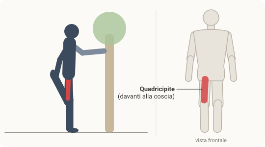
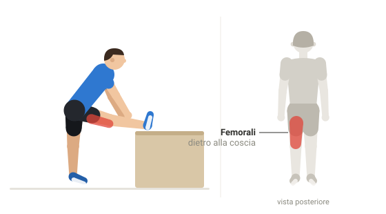
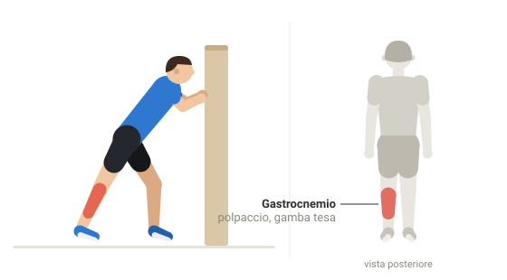
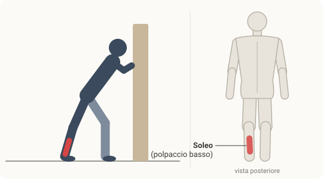
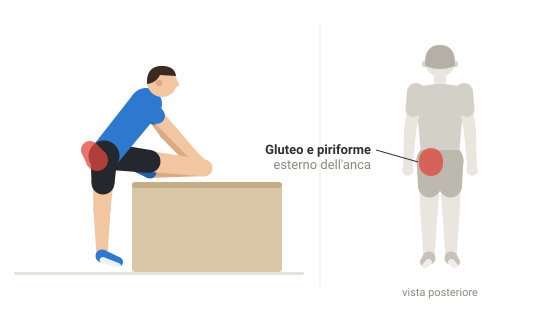
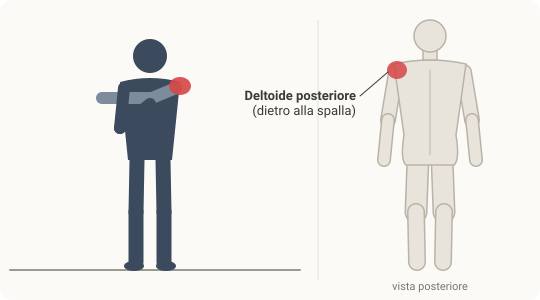
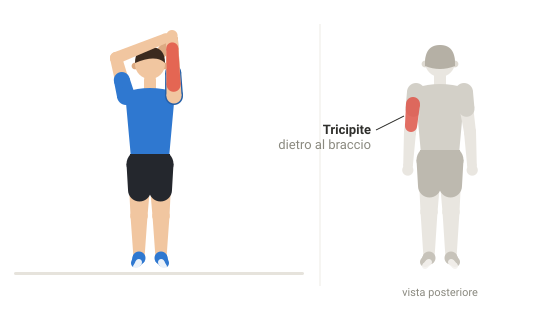

# Gli esercizi di stretching

Il [capitolo 9](09-stretching.md) spiega a cosa serve lo stretching statico e a cosa no. Questo capitolo è la parte pratica: **come si fanno gli esercizi**, a fine corsa, con le figure. Per ognuno c'è anche **dove si può fare**, a casa o al parco, e con quale appoggio: tutti si fanno in piedi, con le scarpe, senza tappetino né asciugamano.

In ogni figura, a sinistra c'è la posizione; a destra il muscolo che si allunga, in rosso, dove va sentita la tensione.

## Le regole, in breve
- **Solo a fine corsa**, a muscoli caldi: mai prima, al posto del riscaldamento.
- **20-30" per esercizio e per lato**, fino a 45" sui punti più rigidi, **1-2 volte**.
- **Tensione leggera, mai dolore**: si arriva al punto in cui si sente tirare e lì ci si ferma. Niente molleggi.
- **Respiro lento**: a ogni espirazione si può andare un poco più in là, senza forzare.
- **Ogni esercizio su entrambi i lati.** Sul lato più rigido si può fare una ripetizione in più.

## Le gambe: la coscia

### Quadricipite (in piedi)

- **Dove:** a casa e al parco. Per l'equilibrio basta un appoggio leggero: un muro, una sedia, un albero, oppure niente.
- **Come si fa:** in piedi su una gamba. Si piega l'altro ginocchio e si prende il piede con la mano dello stesso lato, portando il tallone verso il gluteo.
- **Cosa si sente:** tensione davanti alla coscia.
- **Gli errori da evitare:** il ginocchio che si allontana in avanti o di lato (le ginocchia restano vicine), la schiena che si inarca. Per allungare davvero si spinge leggermente il bacino in avanti, come per mettere la "coda sotto".

### Femorali (tallone su un appoggio basso)

- **Dove:** a casa e al parco. Al parco un muretto o una panchina; a casa una sedia o un gradino. L'appoggio va all'altezza del ginocchio o poco sotto.
- **Come si fa:** il tallone sull'appoggio, gamba tesa, punta del piede verso l'alto. Con la schiena dritta ci si piega in avanti **dalle anche**, le mani verso lo stinco.
- **Cosa si sente:** tensione dietro la coscia, tra il gluteo e il ginocchio.
- **Gli errori da evitare:** curvare la schiena per arrivare più giù (si allunga la schiena, non i femorali), un appoggio troppo alto. Se tira dietro al ginocchio invece che sulla coscia, si piega leggermente il ginocchio.

## Le gambe: il polpaccio

### Polpaccio, gastrocnemio (gamba dietro tesa)

- **Dove:** a casa e al parco: serve solo un muro (o un albero, un palo).
- **Come si fa:** mani al muro, un piede avanti con il ginocchio piegato, l'altro dietro con la **gamba tesa** e il **tallone a terra**. Si porta il peso in avanti verso il muro.
- **Cosa si sente:** tensione nella parte alta del polpaccio della gamba dietro.
- **Gli errori da evitare:** il tallone che si alza, il piede dietro ruotato verso l'esterno (la punta guarda il muro).

### Soleo (ginocchio dietro piegato)

- **Dove:** a casa e al parco, come il polpaccio.
- **Come si fa:** stessa posizione del polpaccio, ma con il piede dietro più vicino e il **ginocchio dietro piegato**, sempre con il tallone a terra. Si scende con il bacino, come per sedersi.
- **Cosa si sente:** tensione più in basso, nel polpaccio vicino al tendine d'Achille.
- **Perché farlo:** il soleo lavora a ogni passo e con il ginocchio teso non si allunga. È l'esercizio più utile per chi ha la caviglia rigida o una storia di fascite plantare o di tendine d'Achille.

**Nota: il sollevamento dei polpacci (calf raise) non è stretching.** È un esercizio di forza, e fa parte del blocco di [forza](17-forza.md). Le due cose si completano: la forza rende il polpaccio più resistente, lo stretching gli restituisce l'escursione dopo la corsa.

## Le anche

### Gamba piegata su un appoggio (gluteo e piriforme)

- **Dove:** al parco su un muretto o una panchina; a casa sul bordo del letto o su un tavolo basso. L'appoggio deve essere stabile e all'altezza dell'anca o poco sotto.
- **Come si fa:** si appoggia la gamba piegata sull'appoggio, con lo stinco di traverso (il piede verso l'altra gamba, il ginocchio verso l'esterno). L'altra gamba resta a terra. Con la schiena dritta si porta il busto in avanti, le mani sul ginocchio.
- **Cosa si sente:** tensione nel gluteo e sul lato esterno dell'anca della gamba appoggiata.
- **Gli errori da evitare:** un appoggio troppo alto (il ginocchio deve stare comodo, senza dolore), la schiena curva. È la versione in piedi della "figura a 4" del capitolo 9.

## Le spalle

### Cross body stretch (braccio davanti al petto)

- **Dove:** ovunque, senza appoggi.
- **Come si fa:** un braccio teso orizzontale davanti al petto, verso la spalla opposta. L'altro braccio lo avvicina al petto spingendo **sopra il gomito**, non sul gomito.
- **Cosa si sente:** tensione dietro la spalla.
- **Gli errori da evitare:** alzare la spalla verso l'orecchio, ruotare il busto per seguire il braccio.

### Tricipite (braccio dietro la testa)

- **Dove:** ovunque, senza appoggi.
- **Come si fa:** un braccio in alto, il gomito piegato, la mano che scende dietro la nuca verso le scapole. L'altra mano spinge piano il gomito verso il basso e verso la testa.
- **Cosa si sente:** tensione dietro il braccio, dalla spalla al gomito.
- **Gli errori da evitare:** inarcare la schiena, spingere la testa in avanti.

## La sequenza a fine corsa

Dal basso verso l'alto, così si cambia posizione il meno possibile. Circa **8-10 minuti**:

| # | Esercizio | A casa | Al parco | Tempo |
|---|---|---|---|---|
| 1 | Polpaccio (gamba tesa) | muro | muro, albero, palo | 30" per lato |
| 2 | Soleo (ginocchio piegato) | muro | muro, albero, palo | 30" per lato |
| 3 | Femorali | sedia, gradino | muretto, panchina | 30" per lato |
| 4 | Gamba piegata (anca) | letto, tavolo basso | muretto, panchina | 30" per lato |
| 5 | Quadricipite | muro, sedia o niente | albero o niente | 30" per lato |
| 6 | Cross body | senza appoggi | senza appoggi | 20-30" per lato |
| 7 | Tricipite | senza appoggi | senza appoggi | 20-30" per lato |

Dopo un lungo o una gara si può arrivare a 45" sui punti più rigidi. Dopo le ripetute brevi basta la sequenza leggera, anche una volta sola per lato.

## Cosa è successo a me

Di solito faccio lo stretching al parco a fine corsa, con le scarpe: per questo ho scelto esercizi in piedi, che si fanno con un muro e un muretto e che posso ripetere uguali a casa. Insisto sul **soleo**, con una ripetizione in più, per la fascia plantare sinistra, e sul lato sinistro in generale, che al test di forza e mobilità del 24/10 era il più debole.

## Cosa vale per tutti

- **Lo stretching si può fare ovunque**: un muro e un appoggio basso bastano per tutto il corpo, a casa come al parco.
- **La posizione conta più del tempo**: 20" fatti bene valgono più di un minuto con la schiena curva o il tallone alzato.
- **Polpaccio e soleo sono due esercizi diversi**: per chi corre servono entrambi.
- **Lo stretching non sostituisce la forza**: i polpacci si rinforzano con il calf raise, non allungandoli.
